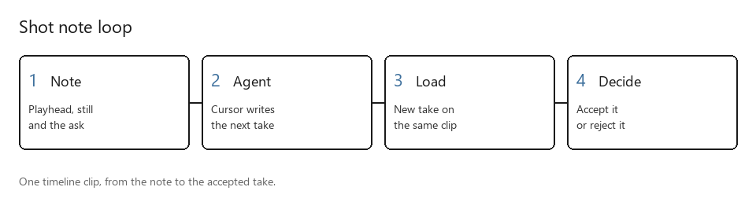
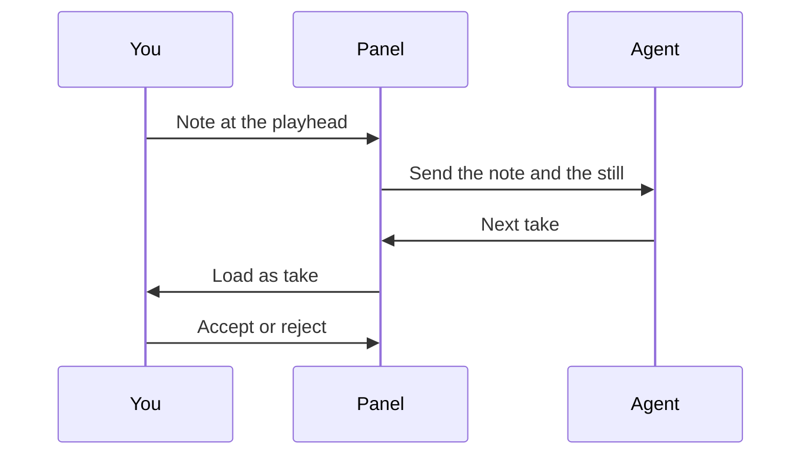

# Imagine Review

A DaVinci Resolve panel for shot notes. You mark a bad frame, a Cursor agent makes the next take, and you accept or reject it on the same timeline clip.



## Why it exists

Notes in a chat lose the frame, the take version and the shot. This panel stores the note on the clip, with a still, and the repair comes back as a take you can flip against the old one before you accept it.

## How it works



- **Panel.** A Resolve Workflow Integration plugin. Workspace, then Workflow Integrations, then Imagine Review.
- **Note.** Shot, take version, timecode and a still. Pick Regenerate, Fix in edit, Question or Approve.
- **Agent.** One Cursor agent per project, through the Cursor SDK. The same notes are available in a Cursor chat.
- **Decide.** Accept makes the new take the clip. Reject puts the old clip back and reopens the note with the reason.

## Results

Measured on Resolve 21.1, on a mixed-dialogue project:

| Check | Result |
|---|---|
| Raw take against the master | 6 to 11 dB too quiet |
| After the line is leveled | The repaired line matched the master, 0.0 LU, instead of falling to the AAC floor at -37.1 dB |
| Reject | Every clip restored |

Picture takes use Resolve's take selector. Audio clips have no take selector, so the new line goes on a temporary track and the two clips are switched by enabling one. `AddTake` returns false unless the Edit or Cut page is open, so a load opens the Edit page first.

## Quick start

Resolve Studio 21.0.4 or later on Windows, Node.js 22.13 or later, and ffmpeg. Workflow Integration plugins need Studio.

```powershell
powershell -ExecutionPolicy Bypass -File scripts\install.ps1
```

Restart Resolve once. The installer signs you in through the browser and stores a named API key under your user profile. `CURSOR_API_KEY`, if set, is used instead. Re-running the installer is safe. `scripts\uninstall.ps1` removes the panel.

To point it at a projects folder:

```powershell
powershell -ExecutionPolicy Bypass -File scripts\install.ps1 -ProjectsRoot "$env:USERPROFILE\projects"
```

<details>
<summary>What a note writes, and the marker colours</summary>

In the project folder:

- `review/notes.jsonl` is the append-only log. `review/notes.md` is the readable copy.
- `review/stills/` holds a frame per note.
- On Accept, `shots/manifest.txt` is updated and the replaced line is kept in `shots/manifest.history`.

Marker colours, if you prefer plain Resolve markers: red is regenerate, yellow is fix in edit, cyan is a question, green is approved. Blue markers are ignored.

From a Cursor chat the tools are `review_status`, `review_harvest`, `review_list_notes`, `review_get_note`, `review_comment`, `review_set_status`, `review_report_candidate` and `review_send_to_panel_agent`.

`npm test` checks project names. `npm run test:level` checks the leveling tool on a synthetic project.

`node service\dist\cli.js status` shows the service and the sign-in. The panel appears in the Workflow Integrations menu only after Resolve restarts.

</details>

## How it was built

Built by directing AI coding agents in Cursor. I set the design and the acceptance bar. The agents wrote the code. No license file: all rights reserved.
